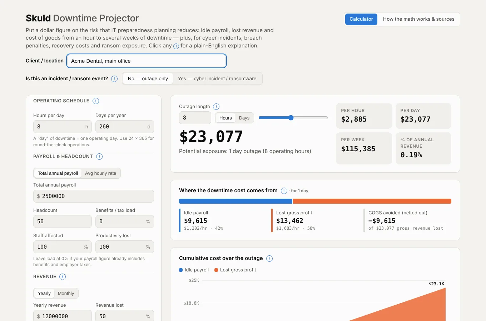
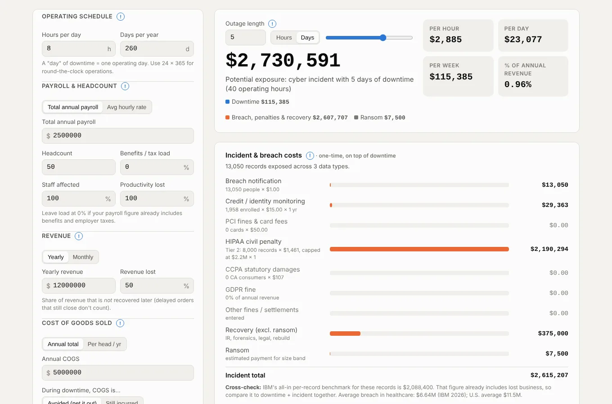
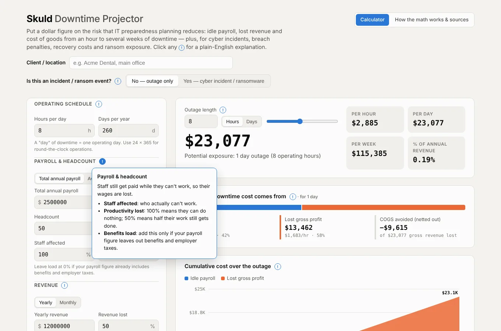
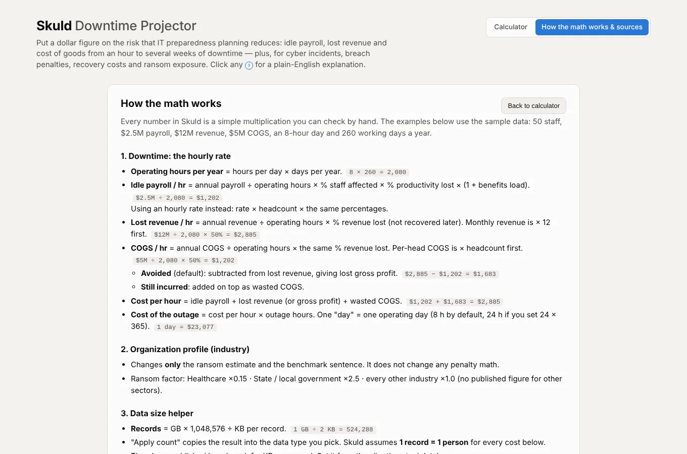
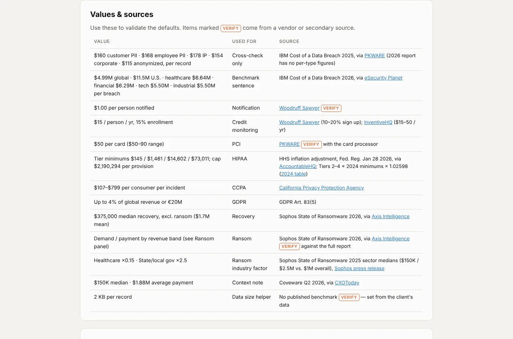

# Skuld — Downtime Projector

**Put a dollar figure on downtime and cyber-incident risk, so IT preparedness planning has a number attached.**

Skuld is a single HTML file. It needs no installation and no server. Open it in any modern browser, enter a business's payroll, revenue and cost of goods, and see what an outage of an hour, a day or a month would cost. Switch on incident mode to add breach notification, credit monitoring, regulatory penalties, recovery costs and a ransom estimate.

### ▶ [Launch Skuld in your browser](https://caitous.github.io/Skuld-DowntimeProjector/) &nbsp;·&nbsp; ⬇ [Download the latest release](https://github.com/CAITOUS/Skuld-DowntimeProjector/releases/latest)

No sign-up and no install. It opens with sample numbers so you can look around right away. Your inputs are saved in your own browser only.



---

## What it does

- **Downtime cost.** Idle payroll, lost revenue and cost of goods, turned into a cost per hour and projected from 15 minutes to 60 working days. Enter payroll as a yearly total or an average hourly rate, revenue yearly or monthly, and cost of goods as a yearly total or per head.
- **Realistic dials.** Share of staff affected, share of productivity lost, benefits load, and the share of revenue that's truly lost rather than just delayed. Cost of goods can be treated as avoided (giving lost profit) or still paid.
- **Incident / ransomware mode.** Answer "Is this an incident or ransom event?" with Yes to add one-time breach costs on top of downtime:
  - **Data exposed** by type: customer PII, employee PII, health records, payment cards, intellectual property, corporate and anonymized data. Don't know the count? Estimate it from data size in GB.
  - **Fees and penalties:** notification, credit monitoring, PCI, HIPAA (by tier, with the annual cap), CCPA, GDPR and any other fines you know about.
  - **Recovery cost** (incident response, forensics, legal, rebuild).
  - **Ransom estimate** from the business's revenue band and industry.
- **Cross-check.** Compares the result with IBM's all-in cost-per-record and industry breach averages, so you can see whether the inputs are too light.
- **Milestone table and chart.** Cost at 1, 2 and 4 hours and 1, 2, 3, 5, 10 and 20 days, plus a cost-over-time chart you can hover.
- **Plain-English help.** Every section has a **!** button that explains it simply. The **How the math works & sources** tab shows every formula with a worked example, and lists each default value with its source.
- **Copy summary.** One click copies the figures as text, ready for a proposal or email.

| | |
|---|---|
|  |  |
|  |  |

---

## Quick start

1. **Open Skuld**, either way:
   - **In your browser:** [caitous.github.io/Skuld-DowntimeProjector](https://caitous.github.io/Skuld-DowntimeProjector/). Nothing to download.
   - **Offline copy:** download `Skuld.html` (app only) or `skuld-<version>.zip` (app, guides, license) from [Releases](https://github.com/CAITOUS/Skuld-DowntimeProjector/releases/latest), then open `Skuld.html`.
2. **Enter the client or location** at the top. It's included in the copied summary.
3. **Fill in the operating schedule, payroll, revenue and cost of goods.**
4. **Set the outage length** in hours or days, or drag the slider.
5. **For a cyber incident,** choose **Yes** and fill in the industry, records exposed and any penalties that apply.
6. **Copy summary** and paste it into your proposal.

---

## How accurate is it?

Skuld gives planning estimates, not quotes. Downtime figures are only as good as the payroll, revenue and loss percentages you enter. Incident figures use published industry averages (IBM, Sophos, Coveware, HHS, the California Privacy Protection Agency) that vary widely from case to case. HIPAA is modeled worst case, and CCPA at the statutory minimum. The **How the math works & sources** tab lists every value and flags the ones to verify. Nothing in Skuld is legal, financial or insurance advice.

---

## Repository contents

```
Skuld.html             The app (single file)
index.html             Opens Skuld.html when the site is visited (GitHub Pages)
.nojekyll              Serve files as-is on GitHub Pages
skuld.json             Version file that copies of Skuld check for updates
.github/workflows/     Release workflow: builds the download package for each new version
docs/RELEASING.md      How to publish a new version
docs/images/           Screenshots used in this README
CHANGELOG.md           Version history
LICENSE.md             License terms
```

## Requirements

- Any current browser: Chrome, Edge, Brave, Firefox or Safari.
- Works offline. Fonts load from Google Fonts when online and fall back to system fonts otherwise.
- Nothing is sent anywhere. Your inputs are saved in your browser's local storage only.

---

## License

© 2026 Triston Hughes. All rights reserved. Free for personal, educational and internal organizational use. Not for resale, sublicensing or distribution by value-added resellers. See [LICENSE.md](LICENSE.md).

Built by **Triston Hughes** · [LinkedIn](https://www.linkedin.com/in/triston-hughes-949420242/) · [Portfolio Toolbox](https://triston-hughes.vercel.app/)
